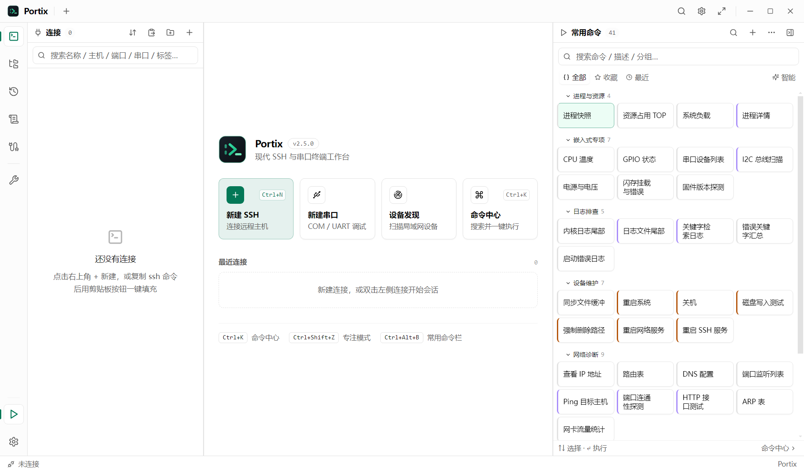
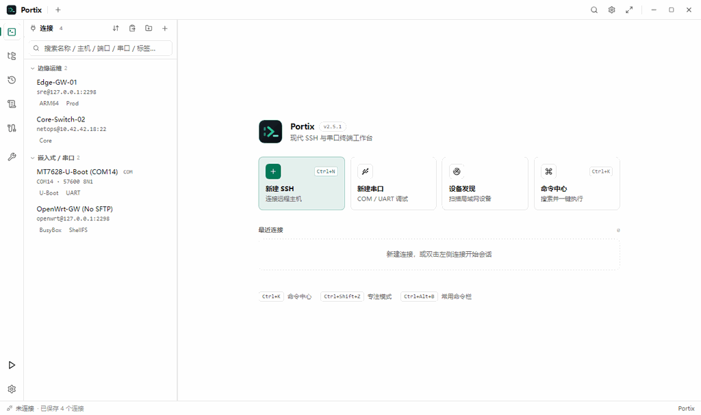
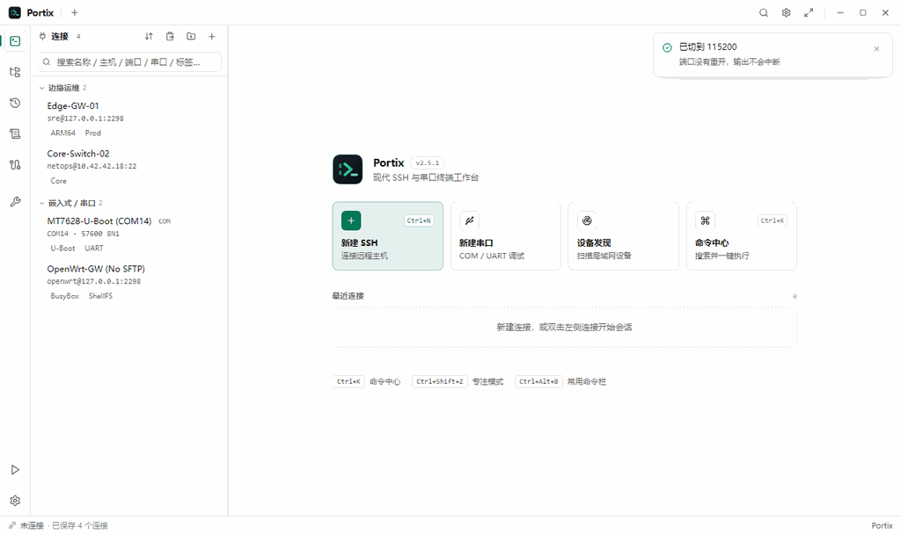
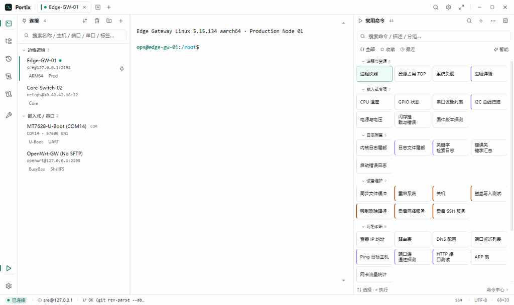

# Portix

English | [简体中文](./README.zh-CN.md)

Open-source, zero-telemetry desktop SSH & Serial terminal workbench for embedded engineers, SREs, and field operations (MobaXterm / Xshell alternative built with Electron, React, and TypeScript).

> **Naming & repository note:** Starting from **v2.5.1**, the application has been rebranded to **Portix** (window title, app icon, and `Portix.exe`). To keep in-app auto-update feeds and existing user data compatible across upgrades, this canonical public repository (`yanxici/ssh-workbench`), release installer filenames (`ssh-workbench-Setup-*.exe` / `ssh-workbench-*-win.zip`), and local data directory (`%APPDATA%/ssh-workbench/data/`) keep the original `ssh-workbench` identifier. They belong to the exact same project.



## Live demos

### 1. Serial U-Boot Auto-Burst & Built-in TFTP Flashing
Countdown burst (`2`) catches the 2-second U-Boot boot window automatically, serves firmware via the built-in RFC 1350 TFTP server (`blksize=1468`), and switches baud rate live (`57600 → 115200`) without reopening the port.



### 2. Zero-SFTP BusyBox Fallback (ShellFS) & Remote Editor
When `sftp-server` is missing on embedded OpenWrt / BusyBox devices, Portix falls back automatically to POSIX Shell (`Shell 兼容`), tracks terminal `cd`, and edits remote config files with automatic `.bak` backup.



### 3. Command Center (`Ctrl+K`) & 31-Check Diagnostics HTML Export
Jump to saved commands via fuzzy `Ctrl+K` search, run all 31 BusyBox-friendly diagnostics checks with live progress, and export a self-contained HTML report for field handoff.



## Download & install

Windows 10/11 (x64) only. Pick one of the three packages — **use the [Gitee mirror](https://gitee.com/w3554334905/ssh-workbench/releases) from mainland China**, [GitHub Releases](https://github.com/yanxici/ssh-workbench/releases) everywhere else. Same files, same version:

| Package | File name | Best for |
| --- | --- | --- |
| Installer (recommended) | `ssh-workbench-Setup-2.5.4.exe` | Installs into the system, supports in-app auto-update |
| Portable | `ssh-workbench-2.5.4-portable.exe` | Run from a USB stick / jump host, writes no registry keys |
| Zip bundle | `ssh-workbench-2.5.4-win.zip` | Unzip and run; easiest to mirror onto an internal share |

- Always latest: <https://github.com/yanxici/ssh-workbench/releases/latest>
- Pinned: <https://github.com/yanxici/ssh-workbench/releases/tag/v2.5.4>
- Integrity: `latest.yml` in the same release carries the sha512 of each artifact.

**Mainland China**

1. Primary: <https://gitee.com/w3554334905/ssh-workbench/releases> — mirrored in sync with GitHub, no proxy needed.
2. Pinned: `https://gitee.com/w3554334905/ssh-workbench/releases/download/v2.5.4/` + the file name above.
3. GitHub + proxy prefix (third-party relay, availability not guaranteed): `https://gh-proxy.com/https://github.com/yanxici/ssh-workbench/releases/download/v2.5.4/` + file name.
4. Internal mirror (most reliable): copy `ssh-workbench-2.5.4-win.zip` to a company share or artifact store and link it here — `<internal mirror URL>`.

> In-app auto-update now uses an automatic multi-channel feed: without a proxy it tries the official Gitee mirror first and falls back to GitHub Releases and built-in mirrors (verifying the first-party sha512 before downloading from any third-party relay); with an update proxy configured it prefers GitHub first for differential updates. You can also pick a specific channel or custom feed URL under Settings → Updates.

> UI language: Full bilingual **Simplified Chinese / English** UI (`verify-i18n` enforced at **0** hardcoded UI lines), switchable live under Settings → General.

## Features

**Connections & terminal**
- Connection manager with groups (create, rename, delete, drag-to-reorder), tags and colors; password, private key (PEM / OpenSSH / PuTTY `.ppk`), SSH agent and keyboard-interactive auth
- ProxyJump chains, SOCKS5 / HTTP CONNECT proxies
- Paste an `ssh user@host -p 22` command from the clipboard to create a connection
- Multi-tab terminal (xterm.js) with search, custom shortcuts and ZMODEM (`rz` / `sz`; `sz` downloads stream in chunks to a folder you pick)
- Encrypted connection export / import between machines
- Auto-reconnect on connection drop with visible error logs
- In-app auto update: a badge in the title bar advertises new versions, with a version diff, the release notes and a one-click install (differential download, usually a few MB)
  > Only the NSIS installer supports auto-update. The portable exe and zip builds ship no update metadata — upgrade them by downloading the new version and overwriting.

**Serial console** (v2.0.0)
- Connect a device over USB-to-serial and type commands in the same tabbed terminal — no second tool needed for a field visit
- Baud rate, data bits, parity, stop bits and flow control; line ending (CR / LF / CRLF, default CR) and encoding (UTF-8 / GBK / GB18030)
- Optional per-character and post-newline send delays: pasting a long command into U-Boot or a 9600-baud device no longer has bytes swallowed
- Switch baud rate without reconnecting: `port.update()` changes the UART divider only, so the port object and its event subscriptions survive — the boot log you were reading does not vanish mid-line, and a board with an auto-download circuit is not reset by a reopen (115200 at power-up, 9600 once the system is up; or jump to 57600 to catch a U-Boot prompt)
- Send BREAK (`port.set({ brk })`, 50–2000 ms): the only way to interrupt a board that is already auto-booting into a maintenance prompt, with the release always executed so TX never stays pinned low
- Every recording is written twice: the asciinema `.cast` for playback, plus a plain-text `.log` with ANSI stripped, `[HH:MM:SS.mmm]` timestamps and a `> ` prefix on what you typed — grep-able, paste-able into a chat, ready to line up against device logs and captures; both are optional and each has its own 50 MB cap
- Port list refreshes itself (2 s poll): unplugging a cable shows "waiting for device", plugging it back reconnects automatically without burning a retry backoff
- Devices are matched by USB identity (`serialNumber` → `pnpId` → COM number), so a device that comes back on a different COM port is still the same device — and a different device on the old COM port is never mistaken for it
- DTR auto-reset is off by default (pulling DTR reboots ESP32 / STM32 boards with an auto-download circuit)
- Serial sessions deliberately expose only the terminal: metrics, diagnostics, firmware, batch, SFTP and tunnels all run remote commands and stay SSH-only
- Serial connections export / import like SSH ones; the USB identity travels with them, and a port that does not exist on the target machine is flagged "needs confirmation" instead of failing at connect time
- A "7628 U-Boot console" preset in the connection editor (57600 8N1, no flow control, CR) so flashing needs no memorised parameters
- A flashing guide bar above every serial session: U-Boot's 2-second window no longer needs luck — one click counts down 6 s, then bursts `2` every 250 ms for 16 shots to cover the whole window, with one button each for `Y`, Enter and the firmware name
- A built-in TFTP server (RFC 1350, read-only, `blksize` / `tsize` negotiation): pick the firmware, start it, and the pane shows the local NIC address plus transfer progress — no external tftp tool

**Command panel**
- One-click saved commands with `{{variables}}`, dangerous-command confirmation, groups, drag-and-drop, search, favorites and history
- JSON import / export
- Always-on command rail on the right (`Ctrl+Alt+B` to toggle): column count follows the pane width — 3 columns below 360 px, 4 below 480 px, 5 above — with two-line labels, no per-card icon or command line, and a 2 px accent strip (needs confirmation > pinned > has variables > plain). Arrow keys step by the real column count; hover shows the full command in a self-drawn tooltip
- Command Center (`Ctrl+K`): fuzzy search with Chinese/English synonyms, usage-based ranking, full keyboard control, scope filtering (all / recent / most used / favorites)
- Group fields are searchable comboboxes: the full list shows up on open, typing filters it, and a brand-new group name can be created on the spot

**Files & tunnels**
- SFTP file tree beside the terminal, dual-pane transfer mode, remote edit with automatic `.bak` backup
- **Upload folders** (files panel, session file tree, dual-pane remote pane): the remote side keeps the local directory name (`target/<folder>/...`), empty folders included. Dragging a folder still flattens its contents into the target — the two are now separate code paths
- The file tree follows the terminal: type `cd /var/log` and the sidebar jumps there, expanding parents as it goes (input tracking plus OSC 7; toggle from the chain icon in the panel header)
- Directories load through one batched IPC call plus a TTL cache, so expanding a deep tree no longer pays one serial round trip per level
- Right-click menu on the sidebar file tree: edit, download file / download directory (expanded recursively), download straight to the local Downloads folder, upload here, new folder, rename, delete
- Transfer queue with live progress and speed; pause / resume (continues from the transferred offset) / cancel (partial files are cleaned up)
- Port forwarding: local (`-L`), remote (`-R`) and dynamic SOCKS5 (`-D`)

**Support workbench**
- Session recording in asciinema `.cast` format, with a player (speed control, export)
- One-click diagnostics: 31 built-in BusyBox-friendly checks plus custom items, exported as Markdown / self-contained HTML
- Batch execution across multiple sessions, with card and side-by-side compare views
- Customer / device profiles and a live resource dashboard (CPU, memory, disk, temperature, network)
- Firmware upgrade helper: upload, SHA-256 verification on both ends, upgrade, wait for reboot
- Device discovery: subnet TCP scan, ARP vendor lookup, reverse DNS, mDNS
- Config backup with line-level diff and restore
- Pack reports, logs, history and backups into a single zip

**Interface**
- Title bar + activity bar + resizable sidebar and command rail (drag to resize, double-click to reset)
- 4 curated high-contrast color themes (Portix Default, Monochrome, Solarized, Dracula), each with light and dark variants (all 8 WCAG >= 4.5:1); UI and terminal colors switch together
- Optimized for large connection lists (2900+ tested): pagination, fold long groups by default, indexed session lookup
- Long command names and command text truncate with an ellipsis instead of overflowing the card; all 12 views audited for text overflow

**Security**
- Credentials encrypted with the OS keystore (Electron `safeStorage`)
- Host key fingerprint verification (OpenSSH-compatible `SHA256:base64`), with **in-place fingerprint update**: probe what the device presents now, review the old → new diff, confirm, done. Reachable from Settings, from the connection editor ("update and retest"), and from the terminal error overlay ("update and reconnect"). Legacy `SHA256:<hex>` records are still recognised and migrated automatically

## Getting started

Requires Node.js 18+.

```bash
npm install --omit=optional   # skip ssh2's optional native addon (no C++ toolchain needed)
npm run dev                   # dev mode with hot reload
```

`.npmrc` points the Electron binary download at the npmmirror mirror. Remove that line if you have direct access to GitHub.

## Scripts

| Command | Description |
|---|---|
| `npm run dev` | Development mode (F12 opens DevTools) |
| `npm run typecheck` | Type-check main and renderer processes |
| `npm run lint` / `lint:all` | ESLint (type-aware for main/preload/shared, React Hooks for the renderer) |
| `npm run check` | `typecheck` + `lint` — run this before committing |
| `npm run smoke` | Build, launch, take a screenshot, exit |
| `npm run build:win` | Build the Windows installer (NSIS) and portable exe; runs the integrity-label check first |
| `npm run build:win:portable` | Build only the portable exe (no install, no registry writes) |
| `npm run check:integrity` / `fix:integrity` | Inspect / repair the directory integrity label (`Low` makes a double-clicked exe silently do nothing) |
| `npm run guard:integrity` / `unguard:integrity` | Install / remove a `WRITE_OWNER` deny guard so sandbox tools can no longer re-stamp the tree as `Low` (see [`docs/archive/RELEASE_CHECKLIST.md`](./docs/archive/RELEASE_CHECKLIST.md) §0.1) |
| `npm run test:cwdfollow` | Regressions for terminal-cwd following (`shellCwd` parser + `cwdStore` session isolation) |
| `npm run test:ipc` | IPC integrity: every channel constant has a registered handler, `ipcMain` count matches, failures wrapped as `{ ok: false }` |
| `npm run test:repository` | Persistence behaviour: credential semantics, group defaults, history cap, settings merge, timeout clamping |
| `npm run test:features` | Host-key fingerprint format/legacy compatibility + folder-upload semantics |
| `npm run test:stress` / `test:stress:e2e` | Scale stress test / real-Electron directory-read stress test |
| `npm run icon` | Regenerate the multi-size app icon |
| `npm run build:mac` / `build:linux` | Build for macOS / Linux |
| `node scripts/verify-*.cjs` | Standalone test scripts for individual modules |

## Data location

`%APPDATA%/ssh-workbench/data/` on Windows (the exact path is shown in Settings).

## Docs

Architecture, directory layout and roadmap (Chinese): [DESIGN.md](./DESIGN.md)

## Version

Current: **v2.5.4** — see [GitHub Releases](https://github.com/yanxici/ssh-workbench/releases), [Gitee Releases](https://gitee.com/w3554334905/ssh-workbench/releases), or [CHANGELOG.md](./CHANGELOG.md) for release notes and version history.

## License

MIT © 2026 yanxici. Full text in [LICENSE](./LICENSE).
