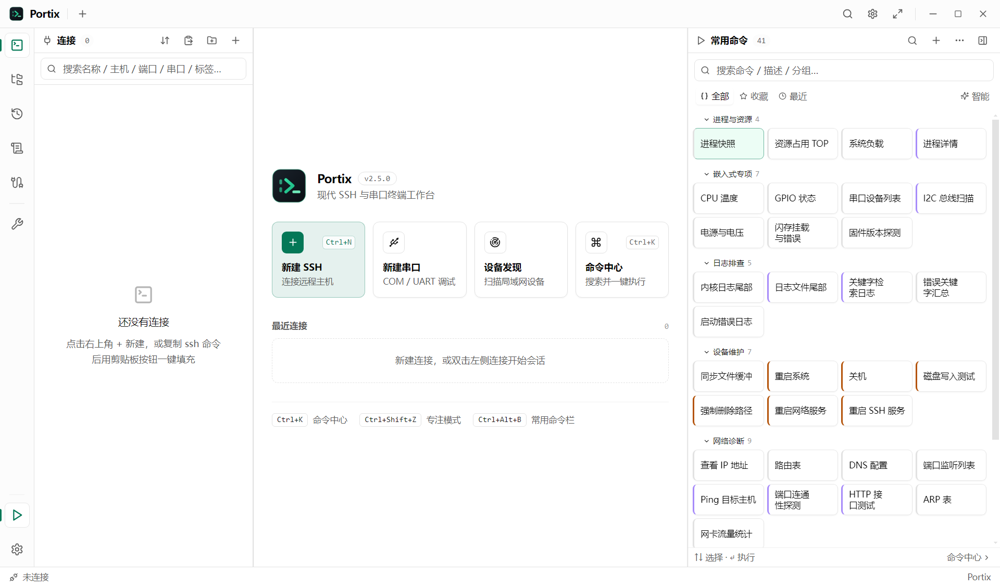
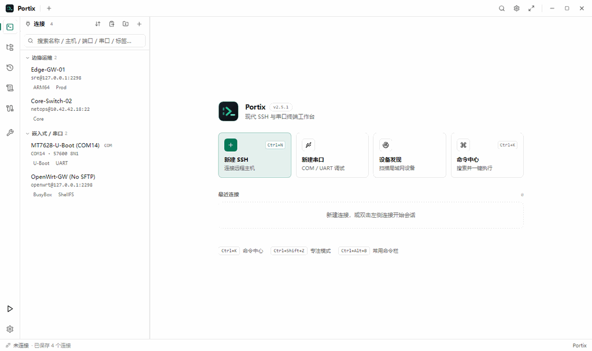
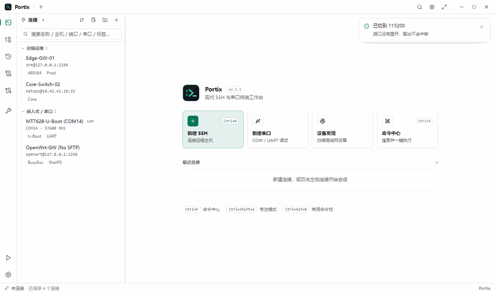
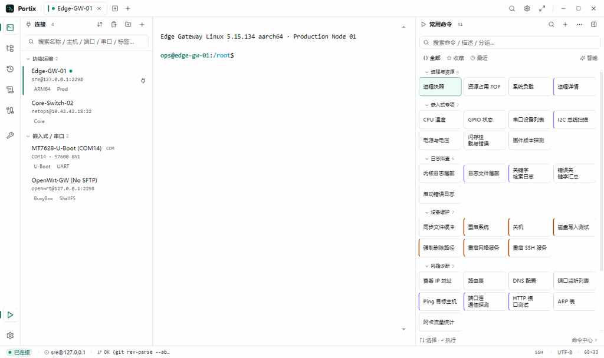

# Portix

[English](./README.md) | 简体中文

面向嵌入式研发、现场运维与 SRE 的开源桌面 SSH 与串口终端工作台 —— 零遥测、免外挂，基于 Electron + React + TypeScript（MobaXterm / Xshell 的离线安全替代方案）。

> **品牌与仓库说明：** 本项目自 **v2.5.1** 起正式启用全新品牌名 **Portix**（窗口标题、图标与主程序 `Portix.exe`）。为保证老版本的应用内自动更新链路及本地历史数据平滑兼容、不触发迁移断档，当前公开主仓库（`yanxici/ssh-workbench`）、安装包文件名前缀（`ssh-workbench-Setup-*.exe` / `ssh-workbench-*-win.zip`）与本地数据目录（`%APPDATA%/ssh-workbench/data/`）仍保留原标识 `ssh-workbench`，两者对应同一项目。



## 核心场景演示

### 1. 串口倒计时连发抢 U-Boot + 内置 TFTP 刷机 + 不重连切波特率
勾选「自动连发」用 250ms 脉冲 `2` 稳稳卡进上电 2 秒 U-Boot 窗口，直接由内置只读 TFTP 服务端（支持 `blksize=1468`）下发固件，并在刷写完成后 `57600 → 115200` 原地切波特率不断流。



### 2. 无 SFTP 的 BusyBox 设备自动降级（ShellFS）+ 远程 `.bak` 编辑
面对未装 `sftp-server` 的 OpenWrt / BusyBox 设备自动切入「Shell 兼容」通道，侧栏跟随终端 `cd` 跳转，并直接双击编辑配置文件（保存时自动保留 `.bak` 备份）。



### 3. `Ctrl+K` 命令中心快速执行 + 31 项内置巡检一键导出 HTML 报告
`Ctrl+K` 模糊检索并执行常用命令，随后一键运行 31 项 BusyBox 兼容系统巡检并导出单文件 HTML 诊断报告用于工单归档或交付。



## 下载安装

只发 Windows 10/11（x64）。三个包任选一个：**国内用 [Gitee 镜像](https://gitee.com/w3554334905/ssh-workbench/releases)**（快，推荐），海外用 [GitHub Releases](https://github.com/yanxici/ssh-workbench/releases)。两边文件同名同版本：

| 包 | 文件名 | 适合谁 |
| --- | --- | --- |
| 安装版（推荐） | `ssh-workbench-Setup-2.5.1.exe` | 装进系统，支持应用内自动更新 |
| 便携版 | `ssh-workbench-2.5.1-portable.exe` | 拷 U 盘 / 跳板机直接用，不写注册表 |
| 免安装压缩包 | `ssh-workbench-2.5.1-win.zip` | 解压即用，适合放进内网共享盘分发 |

- 最新版固定入口：<https://github.com/yanxici/ssh-workbench/releases/latest>
- 指定版本：<https://github.com/yanxici/ssh-workbench/releases/tag/v2.5.1>
- 校验：同目录 `latest.yml` 里带 sha512，下载后可自行核对。

**国内下载**

1. 主入口：<https://gitee.com/w3554334905/ssh-workbench/releases> —— 三个包与 GitHub 同源同步，直连可用。
2. 指定版本：`https://gitee.com/w3554334905/ssh-workbench/releases/download/v2.5.1/` + 上面的文件名。
3. GitHub 备用（加速前缀）：<https://gh-proxy.com/https://github.com/yanxici/ssh-workbench/releases/download/v2.5.1/> + 文件名（第三方中转，可用性不由本项目保证）。
4. 内网分发（最稳）：把 `ssh-workbench-2.5.1-win.zip` 放到公司共享盘或制品库，链接填在这里 —— `<内部镜像地址待填>`。

> 应用内自动更新默认走「自动（优先国内）」多通道：未配代理时优先从 Gitee 国内同源镜像检查与下载，不通自动回退 GitHub 官方与内置加速站（且回退第三方代理时强制校验官方 sha512）；配了更新代理则优先走 GitHub 差量更新。也可在设置 → 软件更新中手动指定通道或点「从 Gitee 下载」。

> 界面语言：目前仅简体中文（工程里还没有 i18n 层）。英文文档只为便于阅读源码，不是英文界面。

## 功能

**连接与终端**
- 连接管理：分组（新建、重命名、删除、拖拽排序）、标签、颜色；支持密码、私钥（PEM / OpenSSH / PuTTY `.ppk`）、SSH Agent、keyboard-interactive 认证
- ProxyJump 跳板链、SOCKS5 / HTTP CONNECT 代理
- 从剪贴板识别 `ssh user@host -p 22` 命令，一键新建连接
- 多标签终端（xterm.js），支持搜索、自定义快捷键、ZMODEM（`rz` / `sz`，`sz` 下载可选保存目录、分块流式写入）
- 连接加密导出 / 导入，可在电脑之间迁移
- 断线自动重连，可见的错误日志
- 应用内自动更新：标题栏亮出「更新」，点开看版本对比与说明，一键下载安装（走差量更新，只需几 MB）
  > 仅 NSIS 安装版支持自动更新。免安装版（portable）与解压版（zip）没有更新元数据，升级请手动下载新版本覆盖

**串口控制台**（v2.0.0）
- 用 USB 转串口线连上设备，在同一个多标签终端里敲命令 —— 跑现场不用再另开一个串口工具
- 波特率、数据位、校验、停止位、流控可配；换行可选 CR / LF / CRLF（默认 CR），编码支持 UTF-8 / GBK / GB18030
- 可选的逐字符间隔与换行后间隔：往 U-Boot 或 9600 的老设备粘长命令，不会再被吞掉中间的字节
- 不用断开重连就能改波特率：走 `port.update()` 只改 UART 分频，端口对象和事件订阅都还在 —— 正在看的启动日志不会断在半行，接了自动下载电路的板子也不会因为重开端口被复位（上电 115200、进系统 9600，或者抢 U-Boot 时切到 57600）
- 能发 BREAK（`port.set({ brk })`，50–2000ms）：板子已经在自动启动时，这是打断它进维护模式的唯一手段；释放无条件执行，TX 不会被钉在低电平
- 每次录制写两份：给回放器用的 asciinema `.cast`，外加一份剥掉控制码的纯文本 `.log`，带 `[HH:MM:SS.mmm]` 时间戳、自己的输入带 `> ` 前缀 —— 能直接 grep、能发到群里，也能拿去和设备日志、抓包对表；两份都可关，各自独立的 50MB 上限
- 端口列表自己刷新（2 秒轮询）：拔线显示「等待设备插回」，插回自动重连，不走 SSH 那套 1/2/4/8 秒退避
- 按 USB 身份认设备（`serialNumber` → `pnpId` → COM 号）：换到别的 COM 口还是同一台设备；反过来，旧 COM 口上插了别的设备也绝不会被当成它
- DTR 自动复位默认关（ESP32 / STM32 的自动下载电路接了 DTR，一拉就重启）
- 串口会话只给终端：指标、诊断、固件、批量、SFTP、隧道都要在远端跑命令，一律只对 SSH 会话开放
- 串口连接和 SSH 一样能导出 / 导入，USB 身份一起带走；对方机器上没有的端口会标成「待确认」，而不是等到连接时才报一句原生错误
- 连接编辑器带「7628 U-Boot 控制台」预设（57600 8N1 · 无流控 · CR），一键套用，刷机不用再记参数
- 串口会话顶部有「串口刷机引导」条：U-Boot 的 2 秒窗口不用抢时机 —— 点一下按钮，倒计时 6 秒后按 250ms 连发 16 个 `2`，把窗口整段盖住；`Y`、回车、固件名各有按钮
- 内置 TFTP 服务端（RFC 1350，只读、支持 `blksize` / `tsize` 协商）：选好固件就能开服，界面上直接给出本机网口地址和传输进度，不必再装一个 tftp 工具

**常用命令面板**
- 单击执行，支持 `{{变量}}`、危险命令二次确认、分组、拖拽、搜索、收藏、历史
- JSON 导入导出
- 右侧常驻命令栏（`Ctrl+Alt+B` 开合）：列数跟着栏宽走 —— 小于 360px 三列、小于 480px 四列、480 以上五列；名字两行显示，卡片里不再放图标和命令行，状态压缩成 2px 左边缘色条（需确认 > 收藏 > 有变量 > 普通）；方向键按实际列数跨行，悬停出完整命令
- 命令中心（`Ctrl+K`）：模糊检索、中英同义、按使用热度排序、全键盘操作、范围筛选（全部 / 最近使用 / 最常用 / 收藏）
- 分组字段是可搜索的组合框：点开即显示全量分组，打字可过滤，也能当场输入新分组名

**文件与隧道**
- 终端旁的 SFTP 文件树、双栏传输模式、远程编辑（自动 `.bak` 备份）
- 文件面板跟随终端目录：终端里 `cd` 到哪儿，侧栏就跳到哪儿并逐级展开（输入追踪 + OSC 7，标题栏链状图标可一键关）
- 目录打开走批量 IPC + 缓存，展开深层目录不再逐层串行等待
- 侧栏文件树右键菜单：编辑、下载文件 / 下载目录（递归展开）、下载到本机「下载」文件夹、上传文件到此处、新建文件夹、重命名、删除
- **上传文件夹**（侧栏文件面板 / 会话文件树 / 双栏远程栏三处入口）：远端保留本地目录名（`目标/<目录名>/...`），空目录也会建出来。拖拽目录上传仍沿用「把内容铺进目标目录」的老语义 —— 两者现在是分开的代码路径
- 传输队列：实时进度与速度，支持暂停 / 继续（从已传位置续传）/ 取消（自动清理半截文件）
- 端口转发：本地（`-L`）、远程（`-R`）、动态 SOCKS5（`-D`）

**技术支持工作台**
- 会话录制（asciinema `.cast` 格式）及回放器（变速、导出）
- 一键诊断巡检：31 项内置检查（兼容 BusyBox）+ 自定义项，导出 Markdown / 单文件 HTML
- 多设备批量执行，卡片视图与对比视图
- 客户 / 设备档案，实时资源仪表盘（CPU、内存、磁盘、温度、网络）
- 固件升级助手：上传、SHA-256 双端校验、升级、等待重启上线
- 设备发现：网段 TCP 扫描、ARP 厂商识别、反向 DNS、mDNS
- 配置备份，行级 diff 对比与还原
- 报告、日志、历史、备份一键打包为 zip

**界面**
- 标题栏 + 活动栏 + 可拖拽侧栏与命令栏（拖动调宽，双击复位）
- 4 套高对比配色主题（Portix 默认、极简黑白、Solarized、Dracula），各含明暗两版（8 组变体全部 WCAG >= 4.5:1），界面与终端联动
- 针对大规模连接列表优化（已测试 2900+ 条连接）：分页、超长分组默认折叠、会话索引加速
- 长命令名与长命令文本一律省略号截断，不再撑出卡片；12 个视图已全量扫描确认无溢出

**安全**
- 凭据使用系统密钥加密（Electron `safeStorage`）
- 主机指纹校验（OpenSSH 兼容的 `SHA256:base64`），支持**就地更新指纹**：探测设备当前值 → 展示「旧 → 新」对比 → 确认后写回。设置面板、连接编辑器（「更新并重测」）、终端报错覆盖层（「更新并重连」）三处入口。历史遗留的 `SHA256:<hex>` 记录仍然兼容，命中后自动迁移成标准格式

## 快速开始

需要 Node.js 18+。

```bash
npm install --omit=optional   # 跳过 ssh2 的可选原生加速模块（无需 C++ 编译环境，不影响功能）
npm run dev                   # 开发模式（热更新）
```

`.npmrc` 已把 Electron 二进制下载指向 npmmirror 国内镜像，能直连 GitHub 的话可以删掉这一行。

## 常用脚本

| 命令 | 作用 |
|---|---|
| `npm run dev` | 开发模式（F12 打开 DevTools） |
| `npm run typecheck` | 主进程 + 渲染层类型检查 |
| `npm run lint` / `lint:all` | ESLint（主进程 / preload / shared 走类型感知规则，渲染层加 React Hooks 规则） |
| `npm run check` | `typecheck` + `lint`，提交前跑这个 |
| `npm run smoke` | 冒烟自检：构建、启动、截图、退出 |
| `npm run build:win` | 打包 Windows 安装包（NSIS）+ 免安装版；前置跑完整性标签检查 |
| `npm run build:win:portable` | 仅打包免安装版（单 exe，不写注册表） |
| `npm run check:integrity` / `fix:integrity` | 查 / 修目录的完整性标签（命中 `Low` 会导致双击 exe 毫无反应） |
| `npm run test:cwdfollow` | 跟随终端目录的两组回归（`shellCwd` 解析 + `cwdStore` 会话隔离） |
| `npm run test:ipc` | IPC 完整性：每个通道常量都有注册点、`ipcMain` 注册数与常量表一致、失败统一包装成 `{ ok: false }` |
| `npm run test:repository` | 数据层行为：凭据三态语义、分组默认值、历史上限、设置合并、超时钳制 |
| `npm run test:features` | 主机指纹格式与旧格式兼容 + 上传文件夹语义 |
| `npm run test:stress` / `test:stress:e2e` | 规模压测 / 真实 Electron 目录读取压测 |
| `npm run icon` | 重新生成多尺寸应用图标 |
| `npm run build:mac` / `build:linux` | 打包 macOS / Linux 版本 |
| `node scripts/verify-*.cjs` | 各模块的独立测试脚本 |

## 数据位置

Windows 下为 `%APPDATA%/ssh-workbench/data/`（设置面板里可以看到具体路径）。

## 文档

整体方案、目录结构、分期路线：[DESIGN.md](./DESIGN.md)

## 版本

当前版本：**v2.5.1**

最近更新：
- **v2.5.1** —— Portix 品牌升级、纯白黑 + 翡翠绿视觉重塑、6 选项卡设置中心与稳定性修复：正式更名为 Portix 并启用全新矢量徽标与 7 尺寸超采样图标；默认外观改为零灰霾纯白/纯黑底配极细边框与翡翠绿点缀，移除暖黄 Gruvbox 并新增「极简黑白」纯黑白配色；设置页升级为双语 6 选项卡双栏结构；精修胶囊标签栏、动态 SSH/串口状态栏、快速启动页、连接与命令卡片对齐，并完成诊断包脱敏及多通道更新竞态修复。
- **v2.5.0** —— 连接搜索精准匹配、折叠分组自动展开、「只看这组」明显状态条、长命令单行提示及全仓 60+ 项稳定性与安全加固：结构化字段（主机、端口、`host:port`、串口、用户名）与纯数字/IP 编号查询改走连续子串匹配，彻底消除搜 `1022` 误命中同 NAT IP 上千台设备的问题；搜索命中时自动临时展开已折叠分组（清空搜索恢复原状）；保留双击分组头「只看这组」并新增顶部高亮状态条、「显示全部」按钮、角标与悬停提示；命令栏长命令悬停改为单行精炼提示不再遮挡半屏；全仓同步完成 SFTP/ShellFS、路径守卫、`JsonStore`、代理粘包、多 `-R` 隧道、`trzsz`、分屏迁移、弹层栈及多通道自动更新的全链路加固（保留主仓技术栈与 Gitee 国内免代理更新通道）。
- **v2.4.3** —— ZMODEM 全链路加固与中断卡死修复：所有中止路径改发标准 10×CAN+10×BS 序列（含补发兜底）彻底解决 `lrzsz` 中断后锁死原始模式终端的问题，抑制窗拦截在途 raw 日志正文并归还焦点；修复实时增长日志卡 100%、高延迟限流误杀、接收队列背压与异步串行落盘、`wx` 防并发覆盖与 Windows 保留名清洗、256MB 上传上限保护、看门狗/取消/关标签句柄释放、节流尾部刷新及侧栏/传输记录面板实时进度条显示。
- **v2.4.2** —— 修复 `sz` 多文件批量下载（如 `sz robottest*`）在多帧 `ZDATA`、0 字节空文件、文件间重传或异步落盘时中止与状态串号的问题；统一接管接收侧协议状态机并延后 `ZRINIT` 至前一份文件落盘完成，传输浮层同步显示多文件批次序号（如 `2/3`）。
- **v2.4.1** —— 修复内置远程编辑器在长/短文件下 `<textarea>` 塌陷成 ~3 行高、下方大片空白的问题；修复系统开启「减少动态效果」或关闭界面动效时 `.motion-off *` 误杀 xterm DOM 光标闪烁动画的问题；修复 Windows 解压版/便携版因无条件绑定 `AppUserModelID` 导致任务栏显示白图标的问题。
- **v2.4.0** —— 嵌入式 SSH 韧性、终端效率迁移与精密仪器风外壳升级：新增老旧设备 SSH 兼容算法开关与一键重连恢复；无 `sftp-server` 设备自动降级纯 Shell/BusyBox 通道；隧道断线自动恢复、随连接自启、远端监听端口一键发现与会话级临时转发；终端拖放文件直传 `cwd`、可编辑多行粘贴确认框、多客户端（`ssh_config`/MobaXterm/Xshell/SecureCRT/FinalShell）一键导入、分屏同步输入与后台标签未读点；外壳收敛为 36px 单色精密顶栏 + 44px 活动栏、主题精简 7→4（v3 静默迁移）、快速启动欢迎页与 `Ctrl+Shift+Z` Zen 专注模式（完整保留主仓技术栈与 Gitee 国内免代理更新通道）。
- **v2.3.2** —— 新增国内免代理应用内自动更新通道：默认「自动」模式优先走 Gitee 同源镜像（通过公开 API 解析最新 tag 并关闭差量规避 Range 200），失败按 `Gitee → GitHub → gh-proxy.com → ghfast.top` 自动回退并在第三方回退时校验官方 `sha512`；设置 → 软件更新支持自选更新通道与内网目录、展示当前命中通道；补充 Gitee Release 同步脚本与 CI 可选同步步骤。
- **v2.3.1** —— 终端默认改用智能 `Ctrl+C` / `Ctrl+V`（有选区复制、无选区透传 `SIGINT`），新增可选「选中即复制」与「右键快速复制粘贴」（`Shift+右键` 出菜单）、单标签 `Ctrl+滚轮` 临时缩放（`Ctrl+0` 复位）、右键导出终端缓冲纯文本、大流量输出 8–32ms 自适应合帧；零依赖升级内置远程编辑器（行号、`Ctrl+F/H` 查找替换、`Ctrl+S` 原地保存、编码与行列状态条、`Tab` 缩进、未保存误关提醒）；修复终端右键「发送文件…」静默失效。
- **v2.3.0** —— 交互反馈落地：命令卡片悬停轻抬、按下回弹，命令墙按 12ms 错峰淡入，连接行扫过亮出品牌色竖条，分组箭头改成同一个图标旋转，设置 → 实验性 → 「界面动效」可一键静止（系统开了「减少动态效果」时自动跟随）。
- **v2.2.1** —— 传输不再"假装完成"：ZMODEM 会续传而不是卡死，上下行都整片落盘，远程编辑不再损坏原文件，新增传输记录面板，刷新文件树不再越展开越慢。
- **v2.2.0** —— 串口：不断开即可改波特率、可发 BREAK；每次录制额外写一份纯文本 `.log`（剥控制码、带时间戳）；只发 LF 的设备不再阶梯错位。
- **v2.1.9** —— 修掉切标签后已结束的 ZMODEM 浮层重现，以及「另存为新设备并连接」丢凭据。
- **v2.1.7** —— 分屏入口补到终端右键菜单，不再只能在标签栏上点。
- **v2.1.6** —— 支持 trzsz 文件传输（`trz` / `tsz`），走文本协议，支持目录与进度条。
- **v2.1.5** —— 嵌套分屏：一个标签最多 4 格，布局按连接持久化。
- **v2.1.4** —— 任务完成通知，通知与否由一层纯决策逻辑判定。
- **v2.1.3** —— 终端输出按关键词行级高亮，设置里带实时试匹配。
- **v2.1.2** —— 找到 WebGL 字形变小的真根因（canvas 字体串多了个前导空格）并修掉。
- **v2.1.1** —— 字形回归的临时绕行：终端渲染器默认回落 DOM。
- **v2.1.0** —— 观感统一：设计 token、统一行高、面板骨架屏、真虚拟滚动。
- **v2.0.0** —— 串口控制台：USB 转串口设备开在同一终端里，附刷机引导条与内置 TFTP 服务端。
- **v1.9.0** —— 命令栏列数跟随栏宽，卡片名字占满整卡宽、最多两行。
- **v1.8.1** —— ZMODEM 收发双向修复（下载卡死、上传停在 0 字节）。
- **v1.8.0** —— 13 处 Enter 消费点补 IME 组合态守卫。
- **v1.6.8** —— CI 门禁拆成 `typecheck + verify` 与 `UI e2e` 两个显式步骤。
- **v1.6.7** —— 修掉批量下载同名文件互相截断，以及 `allowLan` 保存后丢失。
- **v1.6.6** —— 两条 P0：下载覆盖本地同名文件、删除隧道后遗留幽灵转发。
- **v1.6.5** —— 发布链路加固：版本一致性门禁、产物策略统一。
- **v1.6.4** —— 修掉上传文件夹的三个真 bug。
- **v1.6.3** —— 拆掉 `repository.ts` 与 `SettingsPanel.tsx` 两个上帝文件。
- **v1.6.2** —— 引入类型感知 ESLint 并修掉首轮发现的问题。
- **v1.6.1** —— 上传/下载链路收敛进 store，`main/index.ts` 按域拆分。
- **v1.6.0** —— 上传文件夹与主机指纹更新。
- **v1.5.2** —— 修复文件面板不跟随 `cd`。
- **v1.5.1** —— 目录批量读取：256 个目录从 256 次 IPC 降到 1 次。
- **v1.5.0** —— 文件面板跟随终端、应用内自动更新、侧栏右键菜单。
- 更早版本见 Releases 页。

